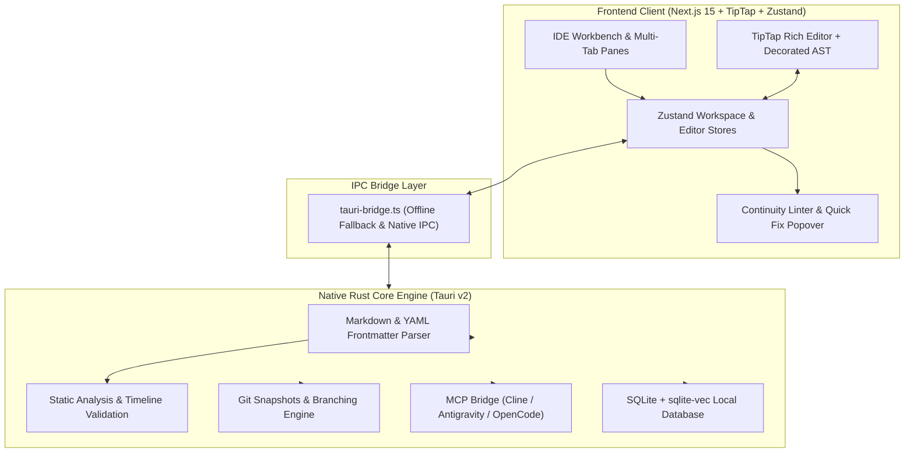

<div align="center">

# 🖋️ NovelForge IDE

> **Trạng thái: MVP đang phát triển (2026-11).** App chạy thật trên desktop (Tauri v2 + Rust): mở thư mục project, đọc/ghi file Markdown thẳng xuống đĩa, linter nhất quán cốt truyện, snapshot Git thật qua libgit2, xuất EPUB 3 / DOCX / PDF (qua hộp thoại in), và MCP stdio server cho agent bên ngoài. Chế độ trình duyệt (`npm run dev`) chạy **dữ liệu mẫu có chủ đích** — không ghi file thật. Xem `.docs/architecture-decisions.md` và `planfix_01.md` để biết giới hạn hiện tại.

### *The Compiler-Grade Desktop IDE for Novelists, Screenwriters & World-Builders*

[](https://nextjs.org/)
[](https://v2.tauri.app/)
[](https://www.rust-lang.org/)
[](https://www.typescriptlang.org/)
[](https://tailwindcss.com/)
[](LICENSE)

<p align="center">
  <b>NovelForge IDE</b> bridges the gap between literary craftsmanship and modern software engineering ergonomics.<br/>
  Featuring real-time narrative continuity linting, cross-chapter safe symbol refactoring, dynamic character relationship graphs, Notion-style lorebook databases, narrative Git snapshots, and multi-agent AI collaboration.
</p>

[Key Features](#-key-features) •
[Architecture](#-system-architecture) •
[Quick Start](#-quick-start) •
[Keyboard Shortcuts](#-ergonomic-shortcuts) •
[Publishing Pipeline](#-publishing-compiler) •
[Contributing](#-contributing)

</div>

---

## 📖 Why NovelForge IDE?

Traditional word processors (**Microsoft Word, Google Docs, Scrivener**) were built for static typography and unstructured prose. They fail when authors face modern complexity:
* ❌ **Plot Holes & Dead Entity Inconsistencies:** A character killed in Chapter 5 accidentally reappears in Chapter 8 without warning.
* ❌ **Destructive Renaming:** Changing a protagonist's name or title breaks nicknames, aliases, and mentions across dozens of chapters.
* ❌ **Disjointed World-Building:** Lore lives in separate wikis or notes disconnected from the actual manuscript editor.
* ❌ **Fear of Plot Experimentation:** Branching out an alternative plotline risks breaking the original manuscript without version control.

**NovelForge IDE treats your novel like a high-performance codebase.** It parses manuscripts into semantic Abstract Syntax Trees (AST), runs real-time static analysis for narrative continuity, models lore as relational databases, and visualizes entity dynamics across chronological timelines.

---

## ⚡ Key Features

### 1. 🛡️ Continuity Linter & Semantic Quick Fixes
* **Compiler-Grade Static Analysis:** Runs background rule checking over all chapters and lore entries.
  * **Rule 1 (Dead Entity Logic):** Flags errors when a deceased or incapacitated character appears in subsequent chapters without a flashback tag.
  * **Rule 2 (Chronology & POV Conflicts):** Verifies chapter frontmatter timestamps and flags impossible travel or simultaneous presence.
  * **Rule 3 (Pacing & Style Repetition):** Detects clustered repetition of sensory adjectives or overused tropes within individual scenes.
* **Inline Squiggly Underlines & Popovers:** Click any warning/error or press `Alt+Enter` to apply **Quick Fixes** (e.g., automatically tag paragraph as `[Flashback]`, update character status, or ignore rule).

### 2. 🔀 Smart Literary Refactoring (`Shift+F6`)
* **Whole-Word & Alias-Aware Renaming:** Safe, project-wide renaming that distinguishes between exact matches, substrings, and contextual aliases (e.g., renaming *"Lâm Vũ Linh"* automatically updates *"Tiểu Linh"* and *"Agent #7"*).
* **Cross-Chapter Sentence Previews:** Displays an interactive diff list across all chapters, allowing you to selectively uncheck specific instances before applying changes.

### 3. 🧬 Notion-Style Lorebook Database & Implicit Entity Linking
* **Structured World-Building Schema:** Manage characters, factions, locations, artifacts, and historical events.
* **Table & Gallery Views:** Filter by category, status (*Alive / Deceased*), faction, or custom attributes.
* **Implicit Linking:** Automatically detects lore mentions in prose without requiring manual `@` tagging, displaying rich hover cards with backlink counts and character stats.

### 4. 🕸️ Interactive Character Relationship Graph (`@xyflow/react`)
* **Live Dynamic Graph:** Visual node-and-edge graph rendered using high-performance React Flow.
* **Time-Scrubber Slider:** Drag the chapter timeline slider to watch alliances, rivalries, and mentorship ties morph and invert across the story's progression.

### 5. 📜 Story Timeline Snapshots & What-If Branching
* **Narrative Version Control:** Tạo Git snapshot thật của manuscript và lorebook (`Ctrl+S`) — commit được ghi qua `libgit2`, chỉ stage `manuscript/` và `lorebook/`.
* **Safe Restore:** Khôi phục snapshot chỉ ghi đè `manuscript/` và `lorebook/` (không đụng file khác, không xóa lịch sử Git, không reset branch) — luôn yêu cầu xác nhận.
* **Honest Delta:** `word_count_delta` được tính từ số từ thật (lưu trong commit trailer `NovelForge-Words`), không phải số giả.

### 6. 📦 Publishing Compiler Pipeline (`Ctrl+E`)
* **Multi-Format Export:**
  * 📕 **EPUB 3 thật** (client-side `jszip`): mimetype chuẩn, `META-INF/container.xml`, `content.opf`, nav — mở được bằng Calibre/Edge.
  * 📄 **DOCX thật** (gói `docx`): định dạng bản thảo (lề 1 inch, giãn dòng đôi, số trang).
  * 📑 **PDF** qua hộp thoại in của hệ thống (chọn "Lưu dưới dạng PDF").
* **Sanitization Engine:** Tự động loại bỏ các khối Ghi chú tác giả (`> [!GHI_CHÚ_TÁC_GIẢ]`) và escape toàn bộ HTML khi xuất bản (chống HTML injection từ chính bản thảo).

### 7. 🤖 Multi-Agent AI Bridge (MCP stdio)
* **MCP Server thật (stdio JSON-RPC):** chạy như một tiến trình riêng — `novelforge-ide mcp [project_root]` — cung cấp 4 tool cho Cline, Claude Desktop, OpenCode:
  * `novel_search_lore(query, entity_type?)` — Hybrid Search (BM25 + vector feature-hash) trên index SQLite của project.
  * `novel_get_chapter_context(chapter_id, window_size?)` — nội dung chương + các chương trước/sau theo thứ tự act/order.
  * `novel_check_continuity(draft_text, chapter_id)` — chạy Continuity Linter thật trên đoạn nháp.
  * `novel_propose_edit(file_path, start_line, end_line, new_content, rationale)` — **không bao giờ ghi đè file**; đề xuất được lưu tại `.novelforge/proposals/*.json` để bạn duyệt.
* **Trong IDE:** tab MCP của AI Dock gọi cùng các tool qua IPC khi project mở trên đĩa; ở chế độ trình duyệt, các nút được gắn nhãn rõ là **"Mô phỏng"**.

### 8. 🎨 Typographic Ergonomics & Zen Focus Mode
* **Three Curated Themes:**
  * 🌑 **Obsidian Dark:** High-contrast, OLED-friendly dark palette for late-night writing.
  * 📜 **Parchment Sepia:** Warm, soothing paper tones optimized for long editing sessions.
  * ☀️ **Daylight Light:** Crisp editorial paper finish with clean serifs.
* **Distraction-Free Zen Mode (`Ctrl+Shift+Z`):** Hides all chrome, toolbars, sidebars, and docks, focusing 100% of your display on the paragraph at hand.
* **Typewriter Scrolling & Paragraph Focus:** Keeps the active writing line centered while subtly dimming surrounding paragraphs.

---

## 🏛️ System Architecture

NovelForge IDE is engineered as an **offline-first hybrid monorepo**:

```
NovelForge_IDE/
├── src/                               # Frontend Presentation & Application Layer
│   ├── app/                           # Next.js 15 App Router (Static Export)
│   │   ├── layout.tsx                 # Root layout & theme synchronizer
│   │   ├── page.tsx                   # Main IDE Workbench container
│   │   └── globals.css                # CSS variables for themes (Obsidian/Parchment/Daylight)
│   ├── components/
│   │   ├── editor/                    # NovelEditor, TipTap integration, SlashMenu, Frontmatter
│   │   ├── lorebook/                  # LoreDatabaseView, CharacterSheet, RelationshipGraph
│   │   ├── workbench/                 # ActivityBar, Sidebar, DockLayout, TabBar, StatusBar
│   │   ├── ai-hub/                    # RightDock, MCP agent diffs & prompt composer
│   │   └── modals/                    # CommandPalette, RefactorRenameModal, PublishModal
│   ├── stores/                        # Zustand reactive state stores
│   │   ├── useWorkspaceStore.ts       # Chapters, Lore entities, Snapshots, Tab manager
│   │   ├── useEditorStore.ts          # Typography, font sizing, active cursor, focus modes
│   │   └── useAgentStore.ts           # MCP bridge, pending diff proposals, agent chat
│   └── lib/
│       ├── tauri-bridge.ts            # High-performance IPC bridge (Rust Tauri ↔ Browser)
│       └── __tests__/                 # Core engine unit test suite (Vitest/Node test runner)
│
├── src-tauri/                         # Rust Core Desktop Engine (Tauri v2)
│   ├── src/
│   │   ├── core_engine/               # AST Parser, Continuity Linter, Refactor engine
│   │   ├── ai_bridge/                 # MCP Server, RAG embeddings & vector indexing
│   │   ├── vcs/                       # Git snapshot engine, diff calculator
│   │   └── commands/                  # IPC Command handlers exposed to frontend
│   ├── Cargo.toml                     # Rust dependencies (tauri, serde, rusqlite, walkdir)
│   └── tauri.conf.json                # Desktop application windowing & security capabilities
│
├── manuscript/                        # User's structured markdown chapters
│   └── act-01/                        # Organized by acts, arcs, and chapters
└── lorebook/                          # Relational markdown files for characters, items, locations
```

### Data Flow Diagram



---

## 🚀 Quick Start

### Prerequisites
* **Node.js:** v18.17.0+ (LTS recommended)
* **npm:** v9.0.0+
* *(Optional for native desktop app)*: **Rust** v1.75+ (`rustup default stable`)

### 1. Clone the Repository
```bash
git clone https://github.com/PTCuong-1102/NovelForge_IDE.git
cd NovelForge_IDE
```

### 2. Install Dependencies
```bash
npm install
```

### 3. Run the Web Application (Demo Mode)
```bash
# Start development server with live reload
npm run dev

# Open in browser: http://localhost:3456
```
> Trong trình duyệt, app chạy **dữ liệu mẫu có chủ đích** (truyện "Huyết Cảng 2026").
> Không đọc/ghi file thật, không gọi Rust. Mở project thật phải dùng bản desktop bên dưới.

### 4. Build Production Static Bundle
```bash
npm run build

# Preview static export
npx serve out -p 3456
# Open in browser: http://localhost:3456
```

### 5. Run Native Desktop App & Open a Real Project (Tauri v2)

**Prerequisites (Windows):** [Microsoft C++ Build Tools](https://visualstudio.microsoft.com/visual-cpp-build-tools/)
with the "Desktop development with C++" workload (provides `link.exe` and the Windows SDK). Rust 1.75+ via rustup.

```bash
# Development mode with native desktop window
npm run tauri dev

# Production standalone executable build
npm run tauri build
```

Khi app desktop mở lần đầu, bạn sẽ thấy màn hình chào với 2 lựa chọn:

1. **"Mở thư mục project…"** — chọn thư mục có cấu trúc:
   ```text
   my-novel/
   ├── manuscript/act-01/*.md     # bản thảo (Markdown + YAML frontmatter)
   └── lorebook/characters/*.md   # hồ sơ nhân vật / địa danh / vật phẩm
   ```
   App đọc/ghi thẳng các file này xuống đĩa (Ctrl+S lưu ngay), không copy đi đâu cả.
2. **"Mở project demo"** — chạy thử bằng dữ liệu mẫu trong bộ nhớ (không đụng ổ đĩa).

**MCP bridge cho agent bên ngoài** (Cline, Claude Desktop, OpenCode) — chạy như một tiến trình stdio riêng, trỏ cwd vào project root:

```bash
# sau khi build/cài đặt, hoặc chạy qua cargo:
cd src-tauri && cargo run -- mcp D:/Project/MyNovel
```

4 tool: `novel_search_lore`, `novel_get_chapter_context`, `novel_check_continuity`, `novel_propose_edit`
(đề xuất sửa KHÔNG bao giờ tự ghi đè file — lưu tại `.novelforge/proposals/*.json`).

> **Note for Linux users:** Ensure native GTK & WebKit libraries are installed:
> ```bash
> # Fedora / RHEL
> sudo dnf install -y gcc webkit2gtk4.1-devel openssl-devel libappindicator-gtk3-devel librsvg2-devel
> 
> # Ubuntu / Debian
> sudo apt install -y build-essential libwebkit2gtk-4.1-dev libssl-dev libappindicator3-dev librsvg2-dev
> ```

---

## ⌨️ Ergonomic Shortcuts

NovelForge IDE is designed for lightning-fast keyboard-driven navigation, mirroring VS Code and JetBrains ergonomics:

| Shortcut | Action | Description |
| :--- | :--- | :--- |
| <kbd>Ctrl</kbd> + <kbd>P</kbd> | **Quick Open** | Search and jump to any chapter or lore dossier instantly |
| <kbd>Ctrl</kbd> + <kbd>Shift</kbd> + <kbd>P</kbd> | **Command Palette** | Execute any IDE command or formatting setting |
| <kbd>Shift</kbd> + <kbd>F6</kbd> | **Smart Refactor Rename** | Project-wide safe character/entity rename with preview |
| <kbd>Alt</kbd> + <kbd>Enter</kbd> | **Linter Quick Fix** | Open remediation actions for continuity errors |
| <kbd>Ctrl</kbd> + <kbd>\\</kbd> | **Split Editor** | Toggle dual-pane side-by-side editing mode |
| <kbd>Ctrl</kbd> + <kbd>Shift</kbd> + <kbd>Z</kbd> | **Zen Focus Mode** | Toggle 100% distraction-free full-screen writing |
| <kbd>Ctrl</kbd> + <kbd>S</kbd> | **Save & Snapshot** | Save manuscript and create a narrative Git snapshot |
| <kbd>Ctrl</kbd> + <kbd>E</kbd> | **Publishing Compiler** | Open export dialog for EPUB, DOCX, and PDF |
| <kbd>Ctrl</kbd> + <kbd>Shift</kbd> + <kbd>E</kbd> | **Manuscript Explorer** | Focus chapters file tree in left sidebar |
| <kbd>Ctrl</kbd> + <kbd>Shift</kbd> + <kbd>L</kbd> | **Lorebook Database** | Focus world-building entries in left sidebar |
| <kbd>Ctrl</kbd> + <kbd>Shift</kbd> + <kbd>M</kbd> | **Continuity Inspector** | Inspect all project plot holes and stylistic warnings |

---

## 🧪 Testing & Verification

```bash
npm test                # frontend: parser, linter, publishers (107 tests)
npm run typecheck       # tsc --noEmit
npm run verify:utf8     # kiểm tra toàn bộ source là UTF-8 hợp lệ
cd src-tauri && cargo test   # Rust: parser, linter, paths, git snapshots, sync→RAG (41 tests)
```

### Verified (2026-11-11)
* `npm test` — **107/107 pass** (gồm round-trip CRLF-safe của `manuscript/*.md` thật).
* `npm run build` — static export tới `out/` thành công; `npm run typecheck` — exit 0.
* `cargo test` — **41/41 pass**, gồm: path-traversal bị chặn, git snapshot create/list/restore
  (restore chỉ ghi đè `manuscript/` & `lorebook/`), và pipeline
  `sync_workspace_to_sqlite` → hybrid RAG search tìm được nhân vật đã seed.
* MCP server kiểm chứng bằng pipe JSON-RPC thật (`initialize`, `tools/list`, `tools/call`):
  trả đúng 4 tool và kết quả thật từ SQLite.

### Test Coverage Highlights
* `✔` **YAML Frontmatter Parser:** lossless round-trip, chịu được file CRLF của Windows.
* `✔` **Implicit Mention Scanner & Continuity Linter (Rule 1, 3):** quét đại từ/biệt danh, bẫy nhân vật đã chết xuất hiện sai thời điểm.
* `✔` **Publishers:** EPUB 3 hợp lệ (mimetype/opf/nav), DOCX hợp lệ, HTML escape chống injection.
* `✔` **Path Traversal Guard:** IPC file commands từ chối path nằm ngoài project root.

---

## 🗺️ Product Roadmap

- [x] Next.js 15 + Tauri v2 Monorepo Core
- [x] TipTap Semantic Editor with YAML Frontmatter Integration
- [x] Continuity Linter Engine (Dead character detection, timeline chronology, style repetition)
- [x] Real Local-First Project Flow — mở/ghi thẳng file `.md` của project (desktop)
- [x] Notion-Style Lorebook Relational Database & Implicit Auto-Linking
- [x] `@xyflow/react` Interactive Character Relationship Graph with Timeline Scrubber
- [x] Cross-Chapter Smart Literary Refactoring (`Shift+F6`)
- [x] Git Story Snapshots via libgit2 (safe restore: chỉ `manuscript/` + `lorebook/`)
- [x] Multi-Format Publishing Compiler (EPUB 3 + DOCX thật, PDF qua print dialog)
- [x] MCP stdio server cho agent bên ngoài (4 tool: search_lore / chapter_context / check_continuity / propose_edit)
- [ ] IDE UI cho MCP proposals (đọc `.novelforge/proposals/*.json` trong AI Dock)
- [ ] Local Offline LLM Integration via `llama.cpp` / Ollama
- [ ] Native `sqlite-vec` vec0 (hiện dùng bảng thường + cosine brute-force; BM25 hybrid đã có)
- [ ] File watcher cho thay đổi từ bên ngoài (`notify`) — hiện chưa có
- [ ] Collaborative Peer-to-Peer Story Review via CRDTs (Yjs)

---

## 🤝 Contributing

Contributions to NovelForge IDE are welcome! Whether you are a writer suggesting workflow improvements or an engineer contributing features:

1. Fork the Project (`https://github.com/PTCuong-1102/NovelForge_IDE/fork`)
2. Create your Feature Branch (`git checkout -b feature/AmazingFeature`)
3. Commit your Changes (`git commit -m 'feat: add some amazing feature'`)
4. Push to the Branch (`git push origin feature/AmazingFeature`)
5. Open a Pull Request

---

## 📄 License

Distributed under the **MIT License**. See `LICENSE` for more information.

---

<div align="center">
  <sub>Crafted with passion for writers and engineers worldwide by <a href="https://github.com/PTCuong-1102">PTCuong</a>.</sub>
</div>
